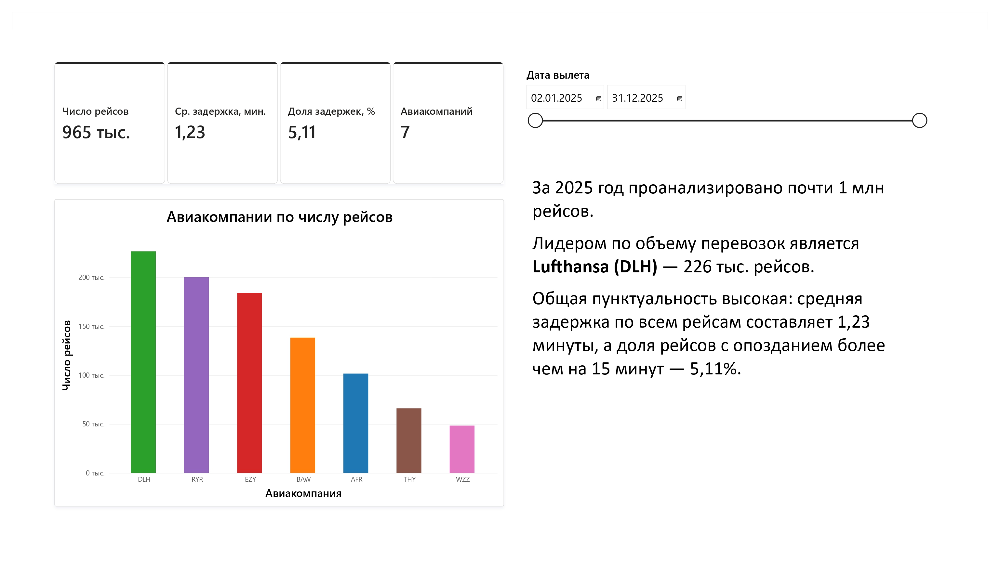
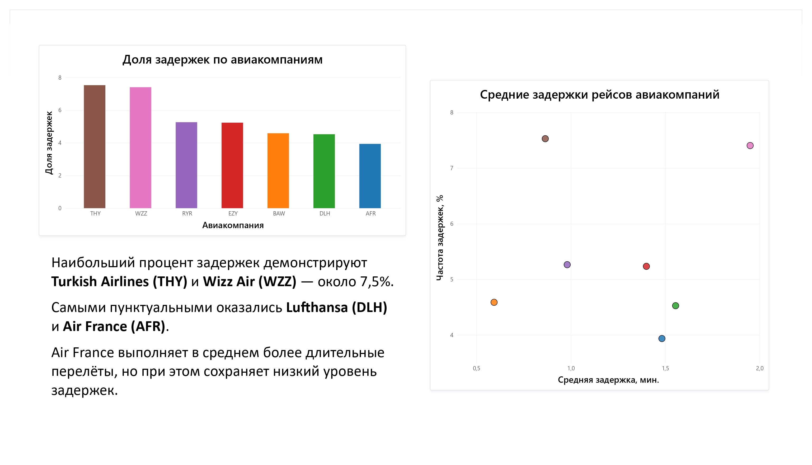
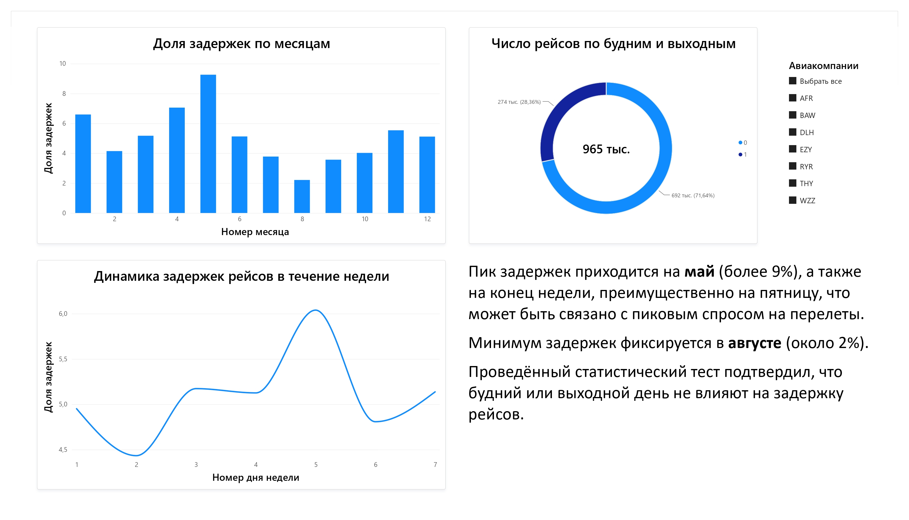
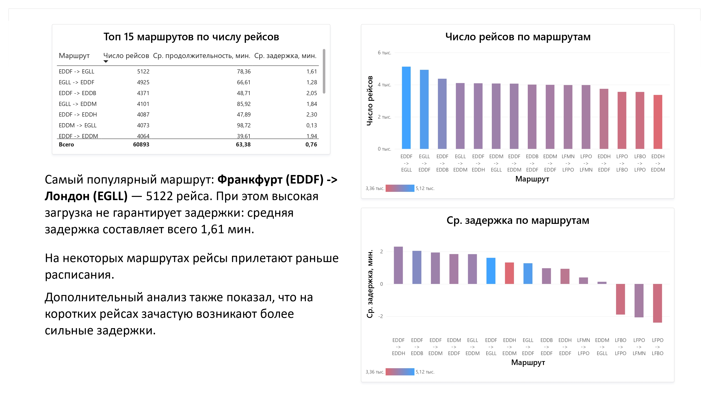

# Анализ авиаперелётов

Статистический анализ датасета авиаперелётов: проверка гипотез, подгонка распределений и оценка задержек на Python, визуализация результатов в дашборде Power BI.

## Данные
`flights.csv` — ~960 тыс. строк, 8 столбцов: авиакомпания, маршрут, аэропорты вылета/прилёта, дата, длительность полёта, задержка.

## Стек
Python (Pandas, NumPy, Matplotlib, SciPy), Power BI.

## Структура
| Папка | Содержимое |
|---|---|
| `notebooks/1_eda_and_stats.ipynb` | EDA, описательные статистики |
| `notebooks/2_distributions_and_hypotheses.ipynb` | подгонка распределений, критерии, доверительные интервалы, гипотезы, корреляции |
| `dashboard/flights_dashboard.pbix` | интерактивный дашборд Power BI |

## Дашборд

## Ключевые результаты
- Доля рейсов с задержкой более 15 минут — 5.11%.
- Lufthansa (DLH) лидирует по числу перевозок — 226 тыс. рейсов.
- Распределение длительности полётов описывается распределением ExpNorm.

## Автор
Окрестин Егор: [GitHub](https://github.com/EgorOkrestin) | [LinkedIn](https://www.linkedin.com/in/egor-okrestin/)